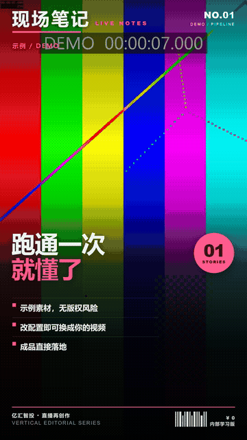

# live-editorial-batch

English ｜ [中文](README.md)



Turn long talking-head footage (livestream recordings, interviews, lectures) into
publish-ready vertical short videos. A single JSON config drives everything:
cover embedded into the first 0.5s, captions that never run ahead of speech, a
measurable 1.5-second visual rhythm, and full-screen live cuts alternating with
structured pages. Runs entirely on your machine.

## What it does

- Cuts 45–60s segments from long footage with frame-accurate 30fps offsets
- Renders the text/graphics layer as HTML in headless Chrome, one deterministic
  screenshot per frame, then composites it over the footage
- Aligns on-screen text to individual words, so a caption never reveals an answer
  before the speaker says it
- Enforces a 1.5s visual rhythm with measurements instead of eyeballing
- Produces a 3:4 publish cover and a 9:16 cover embedded into the video intro
- Fails loudly: every rule is an assertion, plus a final QA gate

## What it does not do

- Not a one-click product: you author a `story.json` (~100 lines, examples included)
- No automatic highlight selection, multi-cam switching, or person tracking
- Vertical 9:16 single-speaker footage only
- No bundled speech model — optional `faster-whisper`, or import an existing SRT

## Install

```bash
python scripts/doctor.py            # reports anything missing
npm install                         # playwright-core
pip install -r requirements.txt     # Pillow
# optional: pip install faster-whisper

cp config.example.json config.json  # then edit `source`
```

System requirements: Python 3.9+, ffmpeg/ffprobe, Node.js 18+, Google Chrome
(or set `CHROME_PATH`).

## Run the demo

```bash
python scripts/make_demo_clip.py                  # 36s synthetic clip, no copyright risk
python scripts/build_batch.py --stage all --only demo01
# output/demo01_run_the_pipeline.mp4
```

## Use your own footage

```bash
# word-level transcript (pick one)
python scripts/transcribe.py input.mp4 -o transcript.json
python scripts/transcribe.py --srt captions.srt -o transcript.json

cp demo/stories/demo01.json stories/v01.json      # edit segments / captions / scenes
python scripts/build_batch.py --stage all --only v01
```

## Pipeline

| Stage | Does | Produces |
|---|---|---|
| `prepare` | injects config into the template, writes subtitles, runs rule assertions | HTML, `captions.ass`, `design.json` |
| `media` | cuts, concatenates, encodes audio | `base.mp4`, `audio.m4a` |
| `covers` | grabs a frame, renders both covers | `cover.png`, `cover_tall.png` |
| `capture` | screenshots the web layer at 30fps | `frame_00000.png…` |
| `render` | composites, PIP, burns subtitles, prepends cover, QA | final mp4 |

## Hard rules

1. **Cover in the intro** — `embed_cover: true` prepends 0.5s (15 frames); QA expects
   `frames + 15` and `duration + 0.5`.
2. **Caption sync** — every `*At` / `beats[]` value must not precede the spoken word;
   a page headline must appear within 1.6s.
3. **1.5s rhythm** — content gaps ≤ 4.5s, merged with 1.5s ticks ≤ 1.5s, plus handheld
   drift on live footage.

## Scene types

`hook`, `verdict`, `list`, `steps`, `versus`, `chain`, `stat`, `quote`, `live`.

## Style presets

`assets/presets/`: `dark-magazine`, `swiss-poster`, `broadsheet`. Never use one style for
more than 5 consecutive videos; at least 3 styles per batch. Light themes require the
extra colour keys documented in `SKILL.md`, otherwise text renders white on white.

## Documentation

- `SKILL.md` — agent-facing workflow and constraints
- `references/story-schema.md` — every field, in Chinese
- `references/style-library.md` — seven style recipes and rotation rules
- `references/qa-checklist.md` — manual acceptance list

## License

MIT. ffmpeg, playwright-core and fonts keep their own licenses — see `LICENSE`.
The demo clip is a generated test pattern and contains no third-party footage.
